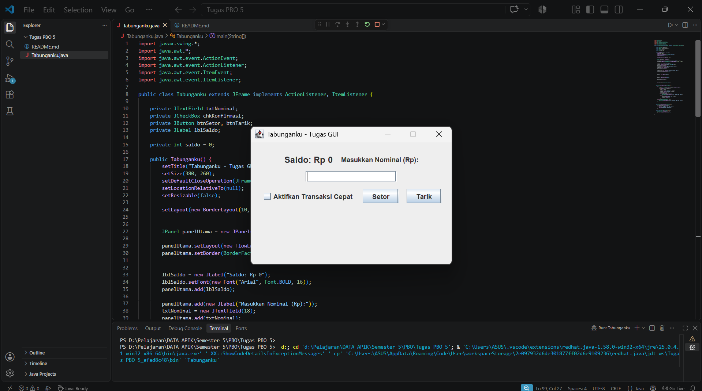
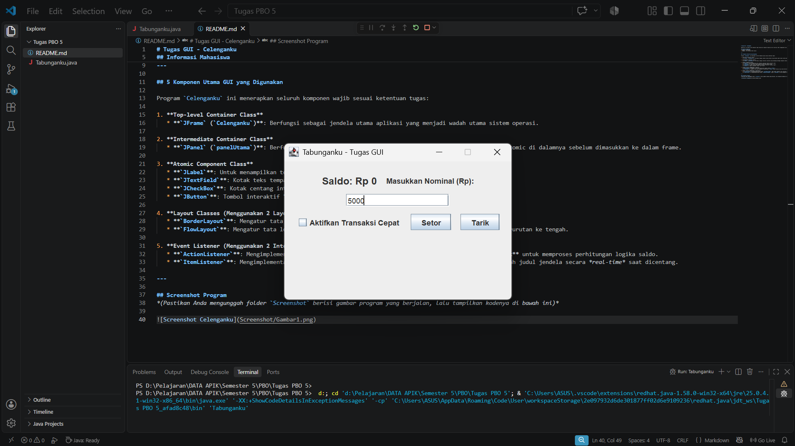
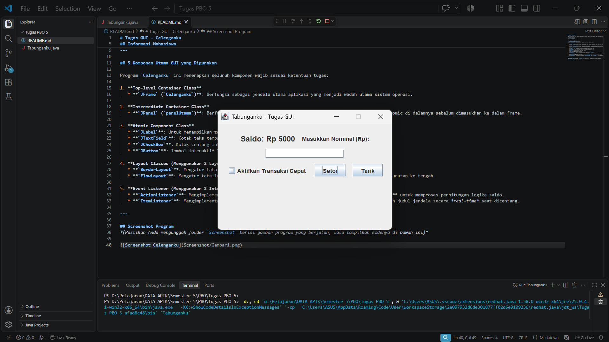
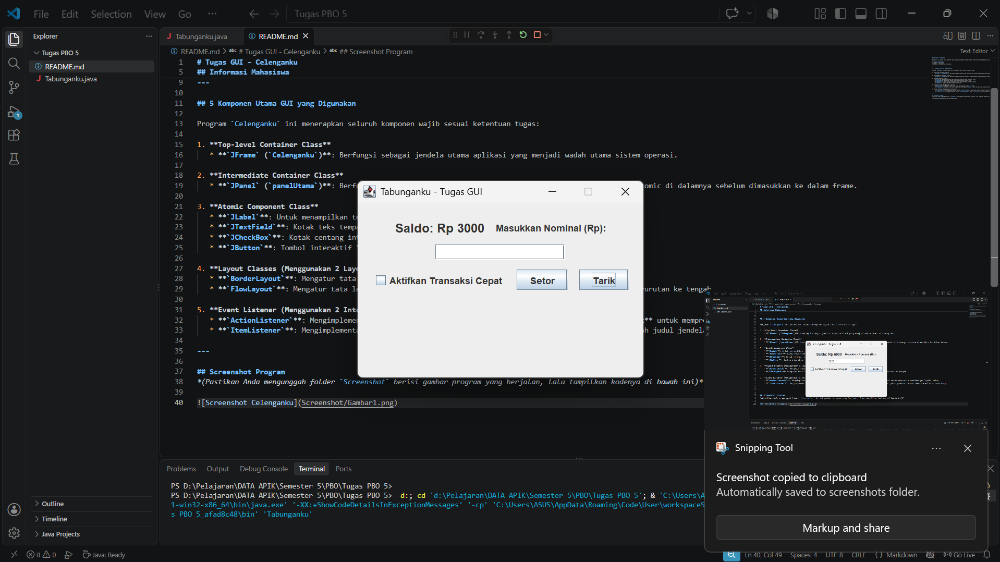

# Tugas GUI - Celenganku

Repositori ini dibuat untuk memenuhi tugas eksplorasi komponen Graphical User Interface (GUI) menggunakan Java Swing.

## Informasi Mahasiswa
* **NIM**: F1D02410012
* **Nama**: Lalu Abdullah Rafi Asyari

---

## 5 Komponen Utama GUI yang Digunakan

Program `Celenganku` ini menerapkan seluruh komponen wajib sesuai ketentuan tugas:

1. **Top-level Container Class**
   * **`JFrame` (`Celenganku`)**: Berfungsi sebagai jendela utama aplikasi yang menjadi wadah utama sistem operasi.

2. **Intermediate Container Class**
   * **`JPanel` (`panelUtama`)**: Berfungsi sebagai kontainer perantara yang menampung berbagai komponen atomic di dalamnya sebelum dimasukkan ke dalam frame.

3. **Atomic Component Class**
   * **`JLabel`**: Untuk menampilkan teks informasi saldo dan label instruksi input.
   * **`JTextField`**: Kotak teks tempat pengguna mengetikkan nominal uang.
   * **`JCheckBox`**: Kotak centang interaktif untuk opsi "Aktifkan Transaksi Cepat".
   * **`JButton`**: Tombol interaktif "Setor" dan "Tarik".

4. **Layout Classes (Menggunakan 2 Layout)**
   * **`BorderLayout`**: Mengatur tata letak utama pada tingkat jendela (`JFrame`).
   * **`FlowLayout`**: Mengatur tata letak komponen di dalam panel (`JPanel`) agar tersusun rapi secara berurutan ke tengah.

5. **Event Listener (Menggunakan 2 Interface)**
   * **`ActionListener`**: Mengimplementasikan method `actionPerformed()` pada tombol **Setor** dan **Tarik** untuk memproses perhitungan logika saldo.
   * **`ItemListener`**: Mengimplementasikan method `itemStateChanged()` pada **`JCheckBox`** untuk mengubah judul jendela secara *real-time* saat dicentang.

---

## Screenshot Program
*(Pastikan Anda mengunggah folder `Screenshot` berisi gambar program yang berjalan, lalu tampilkan kodenya di bawah ini)*

